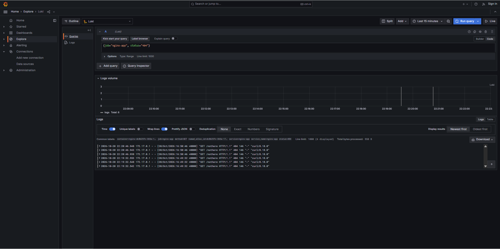

# Loki Log Aggregation

## Stack
Loki 3.2.0, Promtail 3.2.0 and Grafana 11.2.0, started with Docker Compose.
Promtail discovers containers through the Docker socket. It keeps only the
Nomad-launched `nginx-<alloc_id>` container and the local test container `app`.
Grafana is provisioned with a Loki datasource from `grafana-datasource.yaml`
(an addition to the required layout, so the stack needs no manual UI setup).

## How I started it
```bash
cd monitoring
docker compose pull
docker compose up -d
docker compose ps
curl -s localhost:3100/ready     # "ready" after ~15s
```
Grafana: http://localhost:3000 (anonymous admin, local use only). Then Explore, Loki.

## Label set
| Label | Source |
|---|---|
| `job` | static `nginx-app` |
| `container` | Docker container name |
| `nomad_alloc_id` | parsed from the container name `nginx-<alloc_id>` |
| `service` | static `nginx-app` |
| `status`, `method` | extracted from the access log line by a regex pipeline stage |

`curl -s localhost:3100/loki/api/v1/labels` returned:
`container, job, method, nomad_alloc_id, service, service_name, status`
(`service_name` is added by Loki itself.)

## Traffic generated
```bash
for i in 1 2 3; do curl -s -o /dev/null http://127.0.0.1:26707/; done
for i in 1 2 3; do curl -s -o /dev/null http://127.0.0.1:26707/nothere; done
```

## LogQL queries and results
| Query | Result |
|---|---|
| `{job="nginx-app"}` | 12 lines: `GET /` 200 and `GET /nothere` 404 |
| `{job="nginx-app", status="404"}` | 6 lines, all `GET /nothere ... 404 146` |

`curl -s localhost:3100/loki/api/v1/label/status/values` returned `["200","404"]`.
The 404 stream carried `nomad_alloc_id=dc8b25fc-365a-1716-0952-18f5b5979c9d`.



## Problems and fixes
1. **Loki "Ingester not ready: waiting for 15s"** right after startup. This is
   normal warm-up; `/ready` returned ready after about 15s.
2. **Grafana showed "No data"** at first. The query box was empty and no query
   had run. Entering `{job="nginx-app"}` in Code mode fixed it.
3. **Slow image pulls** (Grafana took about 820s). Pulled once up front with
   `docker compose pull`.
4. **Datasource file** was checked for `apiVersion: 1` on the first line, which
   Grafana provisioning requires.
